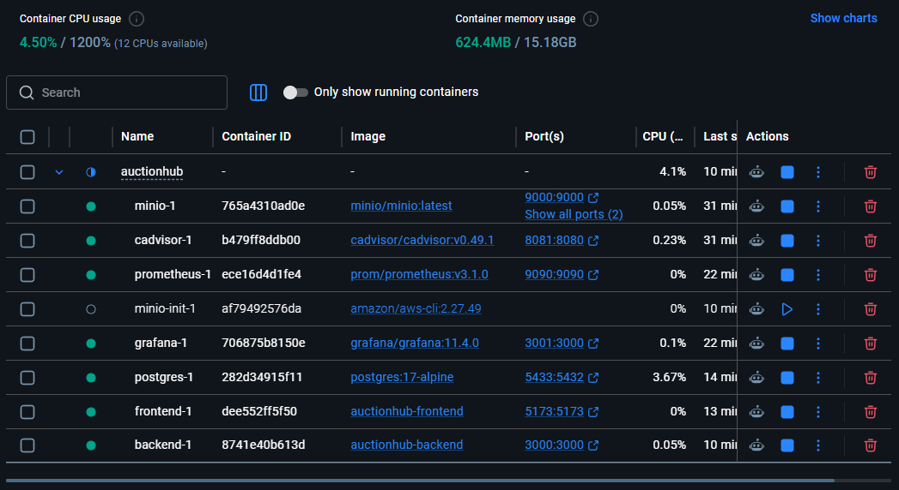

# AuctionHub

AuctionHub es la base de una aplicación de subastas. El repositorio contiene un frontend React con Vite, una API Express en TypeScript y un entorno de desarrollo Docker Compose con PostgreSQL, MinIO y herramientas de observabilidad.

> **Estado actual:** backend y frontend están integrados y operativos con Docker Compose. Se implementó la lógica de subastas, pujas y compra directa con transacciones atómicas en Prisma ORM 8 y bloqueo a nivel de fila (`SELECT ... FOR UPDATE`). La interfaz de detalle de producto en React permite registrar pujas y comprar de forma reactiva con TanStack Query y Zustand. Hot reload verificado en ambos contenedores (`tsx watch` y Vite HMR).

## Captura de los contenedores

La siguiente captura muestra el estado de Docker Desktop durante la configuración: PostgreSQL, MinIO, cAdvisor, Prometheus, Grafana, frontend y backend están activos. `minio-init` aparece detenido porque es una tarea de inicialización que termina correctamente después de crear el bucket.



## Tecnologías

- **Frontend:** React, TypeScript y Vite; están instalados Axios, TanStack Query, Zustand, React Router, Lucide React y Tailwind CSS.
- **Backend:** Node.js, Express y TypeScript ejecutado en desarrollo con `tsx`; Zod, Prisma ORM 8 RC, el cliente S3 de AWS y dependencias de autenticación.
- **Datos y archivos:** PostgreSQL 17 y MinIO compatible con S3.
- **Observabilidad:** Prometheus recoge métricas de Prometheus y cAdvisor; Grafana proporciona la interfaz de visualización.
- **Contenedores:** Docker Compose y Dockerfiles de desarrollo independientes para backend y frontend.

## Requisitos

- Docker Desktop con Docker Compose.
- Node.js y pnpm 10.33.0 para ejecutar frontend o backend fuera de Docker.

## Configuración

1. Clona el repositorio y entra en la carpeta creada:

   ```powershell
   git clone https://github.com/NIC-azo/AuctionHub_seminario_III_27_10_available.git
   Set-Location AuctionHub_seminario_III_27_10_available
   ```

2. Crea los archivos de entorno locales solo si todavía no existen. Así no sobrescribes valores que ya configuraste:

   ```powershell
   if (-not (Test-Path .env)) {
     Copy-Item .env.example .env
   }
   if (-not (Test-Path backend/.env)) {
     Copy-Item backend/.env.example backend/.env
   }
   ```

3. Configura ambos archivos con credenciales locales. `.env` en la raíz es para Docker Compose: revisa `DB_USER`, `DB_PASSWORD` y `DB_NAME`. `backend/.env` es para ejecutar Prisma desde Windows y debe tener un `DATABASE_URL` con el mismo usuario, contraseña y base, usando `localhost:5433`. Dentro de Compose, el backend usa `postgres:5432`; no copies esa dirección interna en el `DATABASE_URL` del host.

   **No publiques `.env` ni `backend/.env` y no reemplaces las plantillas versionadas (`.env.example`).** Cambia las contraseñas de ejemplo antes de exponer el entorno a otras personas o redes. Si ambas formas de conexión se usan contra el mismo servicio, apuntan a la misma base de datos; no son dos bases para migrar por separado.

Docker Compose lee el `.env` de la raíz. Los comandos Prisma que se ejecutan desde `backend` en el host cargan `backend/.env`. Mantén las credenciales de conexión de ambos archivos sincronizadas para que las herramientas locales y Compose trabajen contra la misma base.

## Iniciar el entorno completo

Desde la raíz del proyecto:

```powershell
docker compose up -d --build
```

Este comando inicia los contenedores, pero **no deja activo el observador de archivos**. Para desarrollo con sincronización automática, inicia el entorno en primer plano con:

```powershell
docker compose up --watch
```

Mantén esa terminal abierta mientras desarrollas. Si los contenedores ya están levantados, detén primero el proceso anterior de Compose Watch y luego inicia el observador; no ejecutes dos observadores simultáneos para el mismo proyecto.

Comprueba el estado:

```powershell
docker compose ps
```

Consulta los registros si un servicio no inicia:

```powershell
docker compose logs -f backend
docker compose logs -f frontend
```

Para detener los servicios sin borrar los datos persistidos:

```powershell
docker compose down
```

Los datos de PostgreSQL, MinIO, Prometheus y Grafana se guardan en volúmenes de Docker. No uses `docker compose down -v` salvo que quieras eliminar esos datos.

## Servicios y puertos

Los puertos externos los define el `.env` de la raíz; los valores de la plantilla son:

| Servicio | URL o puerto local | Uso |
|---|---|---|
| Frontend | <http://localhost:5173> | Aplicación React/Vite |
| Backend | <http://localhost:3000> | API Express |
| Backend health | <http://localhost:3000/health> | Comprueba que la API responde |
| PostgreSQL | `localhost:5433` | Base de datos; dentro de Compose escucha en `postgres:5432` |
| MinIO API | <http://localhost:9000> | API compatible con S3 |
| MinIO Console | <http://localhost:9001> | Consola de administración de MinIO |
| cAdvisor | <http://localhost:8081> | Métricas de contenedores |
| Prometheus | <http://localhost:9090> | Consultas y objetivos de métricas |
| Grafana | <http://localhost:3001> | Paneles de observabilidad |

El endpoint `GET /health` devuelve HTTP `200` y `{"status":"ok"}`. Grafana usa el usuario `admin`; la contraseña se define mediante `GRAFANA_ADMIN_PASSWORD` en `.env`.

La API también expone `GET /api`, que confirma que el enrutador central está montado.

## Cómo se inicializan los servicios

1. PostgreSQL inicia y Compose espera a que su comprobación de salud sea satisfactoria.
2. MinIO inicia con las credenciales locales configuradas.
3. `minio-init` espera a MinIO, crea el bucket configurado si aún no existe y establece una política de lectura pública para los objetos. Es una tarea de una sola ejecución: **`Exited (0)` significa que terminó correctamente**, no que MinIO haya fallado.
4. El backend espera a PostgreSQL y a que `minio-init` termine. `server.ts` carga el entorno, inicia Express en `0.0.0.0` usando `PORT` y registra `/health`.
5. El frontend inicia Vite escuchando en `0.0.0.0` dentro del contenedor, de modo que el puerto publicado sea accesible desde el host.
6. Prometheus consulta sus propios endpoints y cAdvisor cada 15 segundos; Grafana queda disponible en el puerto publicado.

En la red interna de Compose, los servicios se comunican usando sus nombres de servicio (por ejemplo, `postgres:5432` y `minio:9000`), no los puertos publicados del host.

## Prisma ORM 8

Este proyecto usa Prisma ORM 8 Release Candidate, siguiendo la guía oficial [Set up Prisma ORM from scratch](https://www.prisma.io/docs/prisma-orm/from-scratch). En esta versión el esquema es un contrato en `backend/prisma/contract.prisma`; la conexión se configura en `backend/prisma.config.ts` y el runtime se importa desde `@prisma/orm-postgres`. Por tanto, este backend no usa `@prisma/client`, `schema.prisma`, `prisma generate` ni `migrate dev`.

En Prisma ORM 8, `prisma contract emit` es el paso de generación equivalente al antiguo `prisma generate`; no instala ni genera `@prisma/client`. Los scripts `pnpm dev` y `pnpm start` ya ejecutan `pnpm prisma:emit` antes de iniciar la API. Ejecuta `pnpm prisma:emit` manualmente después de cambiar el contrato o antes de usar tipos generados desde TypeScript.

El contrato inicial contiene:

- `User`: identificador UUID, nombre de usuario y correo únicos, contraseña y rol (`buyer` por defecto).
- `Product`: título, descripción, precios, imagen y estado (`available` por defecto).
- Relaciones de producto con el vendedor y, opcionalmente, con el usuario ganador.

### Primera configuración en una PC nueva

El volumen de PostgreSQL de Docker no se comparte al clonar el repositorio en otra computadora. Para crear una base de desarrollo nueva:

1. Desde la raíz, inicia PostgreSQL y espera a que esté saludable:

   ```powershell
   docker compose up -d postgres
   docker compose ps postgres
   ```

2. Instala las dependencias del backend y ejecuta Prisma desde esa carpeta, para que las migraciones generadas se guarden en el repositorio del host:

   ```powershell
   Set-Location backend
   pnpm install
   pnpm prisma:emit
   pnpm prisma:init
   pnpm prisma:migration:status
   ```

   `pnpm prisma:init` inicializa una base **vacía** a partir del contrato, crea y firma el esquema actual en PostgreSQL y establece la referencia local de migración. Debe ejecutarse una sola vez por base nueva. **No lo ejecutes sobre una base existente que tenga datos o tablas sin revisar primero su estado y hacer una copia de seguridad.**

3. Incluye en el repositorio el baseline inicial y el estado de referencia generados en `backend/migrations/`; son el historial que necesitarán las demás computadoras. Una vez que ese baseline esté en el repositorio clonado, no vuelvas a ejecutar `pnpm prisma:migration:plan --name initial` ni recrees el baseline. Verifica con `pnpm prisma:migration:status`; el resultado esperado es `Up to date`.

Si la base ya existía o ya fue inicializada (por ejemplo, si el volumen de Docker se conserva), no ejecutes `prisma:init`: revisa directamente el estado:

```powershell
Set-Location backend
pnpm prisma:migration:status
```

### Cambios posteriores al contrato

Para un cambio de esquema, trabaja desde `backend` y contra la base de desarrollo correcta:

```powershell
pnpm prisma:emit
pnpm prisma:migration:plan --name <nombre_del_cambio>
```

Revisa el plan y sus operaciones antes de aplicarlo. Si es el cambio esperado:

```powershell
pnpm prisma:migrate
pnpm prisma:migration:status
```

`pnpm prisma:migrate` aplica las migraciones pendientes y avanza la referencia `db`. Conserva en Git los archivos generados bajo `backend/migrations/`, incluyendo las migraciones, `refs` y snapshots que cambien. No ignores ni elimines ese historial: es lo que permite compartir y revisar la evolución del esquema en otras computadoras.

Estos comandos se ejecutan una sola vez contra la base correspondiente. No migres una vez desde Windows y otra vez desde el contenedor: `localhost:5433` (Windows) y `postgres:5432` (red interna de Compose) son rutas diferentes hacia el mismo PostgreSQL cuando ambos usan el servicio y la base configurados en este proyecto. Se recomienda ejecutar Prisma desde `backend` en el host, porque así las migraciones generadas se guardan en la copia del repositorio. Compose inicia el backend y emite el contrato, pero no inicializa ni aplica migraciones automáticamente.

Las carpetas `backend/.agents`, `backend/.claude`, `backend/.cursor` y `backend/.devin` pueden recibir skills al ejecutar `pnpm install` (`prisma skills sync`). El `.gitignore` ignora archivos adicionales generados localmente en esas rutas, pero **los skills que ya están versionados siguen siendo parte del repositorio**. Las carpetas `backend/migrations/` no se ignoran y deben compartirse.

## Base de la API

- `backend/server.ts` configura Express, CORS, JSON, rutas bajo `/api`, manejo centralizado de errores y apagado del servidor.
- `backend/src/database/prisma.ts` crea una instancia compartida del runtime de Prisma ORM 8.
- `backend/src/services/minio.service.ts` sube archivos al bucket configurado y devuelve su URL pública.
- `backend/src/middlewares/auth.middleware.ts` valida tokens JWT y permite restringir rutas por rol (`seller`, `buyer` o `admin`).
- `backend/src/middlewares/error.middleware.ts` normaliza errores HTTP y de validación Zod.
- Los modelos de `backend/src/models/` realizan las operaciones CRUD de usuarios y productos con el runtime Prisma ORM 8.
- Los controladores de `backend/src/controllers/` validan y normalizan las entradas, aplican reglas de acceso/negocio y forman las respuestas HTTP.
- Las rutas de `backend/src/routes/` exponen autenticación, usuarios y productos bajo `/api`.

El registro e inicio de sesión, la gestión básica de usuarios y el CRUD de productos están implementados. Los flujos de pujas, cierre de subastas y compra todavía deben desarrollarse.

## Desarrollo local sin Docker

Cada aplicación tiene su propio `package.json` y lockfile. Instala sus dependencias y ejecuta los scripts desde su carpeta:

```powershell
Set-Location backend
pnpm install
pnpm dev
```

En otra terminal:

```powershell
Set-Location frontend
pnpm install
pnpm dev
```

El backend carga `backend/.env` y utiliza el `PORT` definido allí. Para desarrollo local, configura la URL de PostgreSQL y MinIO con direcciones accesibles desde el host. Vite muestra la URL local al arrancar.

Con `docker compose up --watch` activo, las reglas `develop.watch` sincronizan cambios de archivos fuente de backend y frontend; los cambios en dependencias, configuración de Prisma o Dockerfiles reconstruyen el servicio. `docker compose up -d` por sí solo no activa la sincronización.

## Configuración de observabilidad

Prometheus carga [observability/prometheus/prometheus.yml](observability/prometheus/prometheus.yml). El archivo define objetivos para `prometheus:9090` y `cadvisor:8080`. El estado de esos objetivos puede revisarse en <http://localhost:9090/targets>.

La configuración debe ser un archivo YAML. Si `prometheus.yml` aparece como carpeta en Windows, el montaje de Compose falla porque intenta montar un directorio como archivo.

## Estructura principal

```text
.
├── .env.example
├── docker-compose.yml
├── backend/
│   ├── Dockerfile.dev
│   ├── migrations/
│   ├── prisma.config.ts
│   ├── prisma/
│   │   └── contract.prisma
│   ├── server.ts
│   ├── package.json
│   └── src/
│       ├── database/
│       ├── middlewares/
│       ├── routes/
│       └── services/
├── frontend/
│   ├── Dockerfile.dev
│   ├── package.json
│   └── src/
├── observability/
│   └── prometheus/
│       └── prometheus.yml
└── docs/
    └── images/
        └── containers-running.png
```

## Trabajo pendiente

- Implementar pujas, cierre de subastas y compras; todavía no existen sus rutas ni reglas de negocio.
- Añadir pruebas automatizadas de integración y de navegador para los flujos principales.
- Alinear TypeScript y `typescript-eslint`: el lint actual no se inicia porque `typescript-eslint` 8.72.1 no admite TypeScript 7.0.2.
- Ampliar los paneles de Grafana y la cobertura de observabilidad de la aplicación.

## Anexo: estado del backend y próxima validación por CLI (2026-10-27)

El backend ya tiene una API Express organizada en `backend/src/`:

- `controllers/`: controladores de autenticación, usuarios y productos. Incluyen validación de entradas con Zod, hashing de contraseñas y respuestas HTTP.
- `database/prisma.ts`: instancia compartida del runtime de Prisma ORM 8, que carga el contrato emitido y requiere `DATABASE_URL`.
- `middlewares/`: autenticación JWT, autorización por roles y manejo centralizado de errores.
- `models/`: operaciones de persistencia para usuarios y productos mediante el runtime Prisma ORM 8.
- `routes/`: rutas para registro e inicio de sesión, usuarios y productos, montadas bajo `/api`.
- `services/`: servicio de almacenamiento compatible con S3/MinIO.

Rutas presentes en el código:

| Método | Ruta | Acceso |
|---|---|---|
| `GET` | `/health` | Público; estado del proceso HTTP |
| `GET` | `/api` | Público; estado e información de la API |
| `POST` | `/api/auth/register` | Público |
| `POST` | `/api/auth/login` | Público |
| `GET` | `/api/products` | Público |
| `GET` | `/api/products/:id` | Público |
| `POST` | `/api/products` | JWT y rol `seller` o `admin` |
| `PATCH` | `/api/products/:id` | JWT; propietario o administrador |
| `DELETE` | `/api/products/:id` | JWT; propietario o administrador |
| `GET` | `/api/users` | JWT y rol `admin` |
| `GET` | `/api/users/:id` | JWT |
| `PATCH` | `/api/users/:id` | JWT; propietario o administrador |
| `DELETE` | `/api/users/:id` | JWT; propietario o administrador |

Para crear un producto, `POST /api/products` acepta `multipart/form-data` con los campos `title`, `description`, `initialPrice` e imagen en el campo `image`. Se admiten JPEG, PNG y WebP hasta 5 MB; el archivo se carga en MinIO y la URL se guarda en PostgreSQL. Como alternativa, se mantiene la creación JSON existente usando `imageUrl` en vez del archivo. Debe enviarse exactamente una de las dos formas de imagen.

### Resultado de pruebas CLI (2026-10-28)

Se probaron los endpoints HTTP contra los contenedores activos después de reconstruir el backend:

| Prueba | Resultado |
|---|---:|
| `GET /health`, `GET /api`, `GET /api/products` | `200` |
| Registrar dos vendedores y dos compradores de prueba | `201` cada uno |
| Login correcto / contraseña incorrecta | `200` / `401` |
| Registro con contraseña inválida | `400` |
| Consultar usuarios como comprador | `403` |
| Crear producto sin token / como comprador | `401` / `403` |
| Crear producto multipart con imagen en MinIO | `201` |
| Leer producto y actualizarlo como propietario | `200` / `200` |
| Actualizarlo como otro vendedor / descargar imagen pública | `403` / `200` |
| Eliminar producto y cuentas temporales | `204` |

Las cuentas y el producto creados para las pruebas fueron eliminados; también se borró el objeto de prueba de MinIO. La verificación final encontró cero productos de prueba en la API y cero objetos en el bucket. El backend, PostgreSQL y MinIO permanecieron activos.

Estas pruebas son una validación funcional básica, no una prueba de carga ni de concurrencia. No se cargaron 35 productos porque no se proporcionaron imágenes reales de catálogo. **No se probaron compras ni cinco operaciones concurrentes:** el backend aún no tiene rutas o lógica de compra, pujas o subastas. Será necesario implementarlas antes de validar ese flujo.

El servicio de carga MinIO está conectado al alta de productos. No hay rutas de pujas o subastas en este estado.

## Anexo: frontend e integración con Compose Watch (2026-10-28)

El frontend está organizado por responsabilidad dentro de `frontend/src/`:

- `types/types.bd.ts`: contratos compartidos de usuario, producto, autenticación y errores de API.
- `api/`: instancia Axios con interceptores JWT y normalización de errores, helper de peticiones y funciones para autenticación, productos y perfil.
- `store/auth.store.ts`: sesión Zustand persistida en `sessionStorage`.
- `secure/`: protección de rutas por sesión y rol, y redirección de usuarios autenticados fuera del login/registro.
- `routes/AppRouter.tsx` y `layout/MainLayout.tsx`: rutas, navegación y estructura compartida.
- `app/pages/`: catálogo con búsqueda, registro e inicio de sesión, detalle de producto, publicación y perfil.
- `app/components/ProductCard.tsx`: tarjeta reutilizable del catálogo.

El alta de productos envía `multipart/form-data` con la imagen en el campo `image`; se valida JPEG, PNG o WebP de hasta 5 MB en la interfaz y el backend la almacena en MinIO. El catálogo consume `GET /api/products`. No se muestra una acción de compra porque el backend todavía no implementa ese flujo. Tailwind CSS 4 se carga mediante `@import "tailwindcss";` y el plugin `@tailwindcss/vite`.

### Ejecutar y validar

Desde la raíz, instala las dependencias con `pnpm install` dentro de `frontend/`. Para mantener los archivos del host sincronizados con los servicios de desarrollo, inicia Compose Watch y deja esa terminal abierta:

```powershell
docker compose up --watch
```

No ejecutes dos observadores al mismo tiempo. `docker compose up -d` levanta los contenedores, pero no mantiene Compose Watch activo. Las reglas sincronizan `frontend/src`, `index.html`, `public` y `vite.config.ts`; los cambios de dependencias o Dockerfile requieren reconstruir la imagen. También se puede usar `docker compose watch frontend` si solo se necesita observar el frontend.

La validación realizada en el contenedor Node 24 terminó correctamente con `docker compose exec -T frontend pnpm build` (TypeScript y build de Vite). Se comprobó en navegador la carga del catálogo, el acceso a login/registro y la redirección de `/products/new` a `/login` sin sesión; el backend respondió `200` en `/health`. Además, Compose Watch sincronizó un cambio en `frontend/src` y Vite registró actualizaciones HMR. Para conservar esa sincronización durante el desarrollo, mantén activo el comando de Compose Watch.

`pnpm lint` no se pudo ejecutar: `typescript-eslint` 8.72.1 falla al cargar con TypeScript 7.0.2. Esta incompatibilidad de versiones queda pendiente de corregir. No se crearon cuentas ni productos para estas pruebas de interfaz.

## Anexo: Fase 3 - Transacciones, Pujas y Compras Concurrentes (2026-10-28)

Se amplió el contrato declarativo de Prisma ORM 8 y la lógica del backend para soportar subastas en tiempo real y prevenir condiciones de carrera:

1. **Contrato Prisma ORM 8 (`backend/prisma/contract.prisma`):**
   - Nuevo modelo `Bid` con relaciones `ProductBids` y `UserBids` e índices en `productId` y `userId`.
   - Campos `currentPrice` y `winnerId` vinculados a las relaciones del producto.
   - Migración planificada y aplicada a PostgreSQL 17: `migrations/app/20261029T0045_add_bids_and_transactions`.

2. **Lógica Transaccional Anti-Concurrencia (`backend/src/models/bid.model.ts`):**
   - `createBid()`: ejecuta una transacción atómica con `db.transaction()` aplicando row-level locking (`forUpdate().first()`). Valida que el producto esté disponible (`available`), que el postor no sea el vendedor propietario (prohibición de autopuja) y que el monto supere estrictamente el precio actual o base.
   - `buyProduct()`: transacción atómica con bloqueo a nivel de fila que actualiza el estado a `sold`, asigna `winnerId` y fija el precio final.
   - `listByProduct()`: lista de pujas históricas con `include("user")` y orden descendente cronológico.

3. **Endpoints de API (`backend/src/routes/product.routes.ts`):**
   - `GET /api/products/:id/bids`: listado público de ofertas del producto.
   - `POST /api/products/:id/bids`: registro de nueva puja (requiere JWT).
   - `POST /api/products/:id/buy`: compra directa inmediata (requiere JWT).

4. **Interfaz de Subasta Frontend (`frontend/src/app/pages/ProductDetailPage.tsx`):**
   - Historial de pujas con iniciales de usuario, montos en PEN y marcas de tiempo.
   - Formulario reactivo para ofertar montos superiores al precio actual con invalidación de caché en TanStack Query.
   - Botón de compra directa con confirmación en pantalla.
   - Bloqueo y badges para el vendedor propietario y para el comprador ganador tras la adjudicación.

5. **Verificación de Hot Reload:**
   - **Backend:** `tsx watch` detecta modificaciones y reinicia el servidor en el puerto 3000 de forma automática en el contenedor.
   - **Frontend:** Vite HMR configurado con `server.watch.usePolling: true` sincroniza y actualiza módulos en caliente sin recargar la página.

---

## 📂 Arquitectura y Responsabilidad de Archivos del Proyecto

A continuación se detalla exhaustivamente qué hace y cómo lo realiza cada archivo clave que conforma la solución técnica de **AuctionHub**:

```
auctionhub-project/
├── docker-compose.yml                       # Orquestación de contenedores y observabilidad
├── .env / .env.example                     # Variables de entorno raíz (Docker)
├── prometheus/
│   └── prometheus.yml                      # Configuración de recolección de métricas
├── backend/
│   ├── Dockerfile.dev                      # Entorno contenedor Node.js / TypeScript
│   ├── scripts/
│   │   ├── run-load-and-simulation.ps1    # Script integral de carga masiva y simulación
│   │   ├── backup-db.ps1                  # Respaldo automatizado PowerShell hacia MinIO
│   │   └── backup-db.sh                   # Respaldo automatizado Bash hacia MinIO
│   ├── prisma/
│   │   ├── contract.prisma                # Definición declarativa de modelos de datos
│   │   └── migrations/                    # Historial de migraciones SQL aplicadas
│   └── src/
│       ├── app.ts / server.ts             # Inicialización y arranque del servidor Express
│       ├── database/prisma.ts             # Conexión singleton al cliente Prisma ORM 8
│       ├── services/minio.service.ts      # Integración con MinIO S3 (AWS SDK v3)
│       ├── middlewares/
│       │   ├── auth.middleware.ts         # Validación JWT y control de acceso RBAC
│       │   ├── product-image.middleware.ts# Procesamiento multipart con Multer
│       │   └── error.middleware.ts        # Manejo centralizado de excepciones HTTP
│       ├── models/
│       │   ├── user.model.ts              # Consultas y persistencia de usuarios
│       │   ├── product.model.ts           # Consultas y mutaciones de catálogo
│       │   └── bid.model.ts               # Transacciones atómicas y bloqueo por fila (Pujas/Compras)
│       ├── controllers/
│       │   ├── auth.controller.ts         # Lógica de registro y login (bcrypt + JWT)
│       │   ├── product.controller.ts      # Publicación con subida a MinIO y validación de firmas
│       │   ├── bid.controller.ts          # Endpoints de subastas y adjudicación
│       │   └── user.controller.ts         # Endpoint de consulta de perfil
│       └── routes/                        # Enrutadores REST de Express
└── frontend/
    ├── Dockerfile.dev                      # Entorno contenedor Vite / Node.js
    ├── vite.config.ts                     # Configuración de Vite con Tailwind 4 y Polling HMR
    └── src/
        ├── types/types.bd.ts              # Contratos de TypeScript compartidos
        ├── store/auth.store.ts            # Estado global reactivo de autenticación (Zustand)
        ├── api/
        │   ├── axios.api.ts               # Cliente HTTP con interceptor Bearer JWT
        │   ├── auth.api.ts                # Peticiones de login y registro
        │   ├── products.api.ts            # Peticiones de catálogo, imágenes y subastas
        │   └── users.api.ts               # Petición de perfil de usuario
        ├── secure/
        │   ├── ProtectedRoute.tsx         # Guarda de rutas por sesión y rol
        │   └── RedirectGuestOnly.tsx      # Redirección de autenticados fuera de auth
        ├── routes/AppRouter.tsx           # Definición de rutas SPA (React Router)
        ├── layout/MainLayout.tsx          # Barra de navegación interactiva y pie de página
        └── app/
            ├── components/ProductCard.tsx # Tarjeta visual reutilizable de producto
            └── pages/
                ├── CatalogPage.tsx        # Catálogo con filtros por comunidad/rol y estados
                ├── ProductDetailPage.tsx  # Vista de subasta en tiempo real con pujas y compra
                ├── CreateProductPage.tsx  # Formulario multipart para publicar productos
                ├── AuthPage.tsx           # Formularios de acceso y creación de cuenta
                └── ProfilePage.tsx        # Perfil con métricas de artículos publicados/comprados
```

---

### 1. Infraestructura, Orquestación y Observabilidad

#### `docker-compose.yml`
- **¿Qué hace?**  
  Define, enlaza y gestiona el ciclo de vida de los 7 contenedores del stack (`postgres`, `minio`, `minio-init`, `backend`, `frontend`, `prometheus`, `cadvisor` y `grafana`).
- **¿Cómo lo hace?**  
  - Establece una red unificada (`auctionhub_default`) y volúmenes con persistencia (`postgres_data`, `minio_data`, `prometheus_data`, `grafana_data`).
  - Aplica el **Modelo de Gobernanza y Etiquetado (Fase 5)** mediante labels (`environment: production`, `owner`, `cost-center`, `tier`).
  - Utiliza `develop.watch` para sincronizar automáticamente el código fuente en caliente entre el sistema operativo host y los contenedores.
  - Implementa `cadvisor:latest` (v0.55.1) para extraer métricas precisas del motor de contenedores sin conflictos con el snapshotter de containerd.

#### `prometheus/prometheus.yml`
- **¿Qué hace?**  
  Configura el colector de métricas de Prometheus.
- **¿Cómo lo hace?**  
  Establece intervalos de raspado (`scrape_interval: 15s`) contra dos targets: el propio Prometheus (`localhost:9090`) y cAdvisor (`cadvisor:8080`), permitiendo consultar el consumo de CPU, memoria y E/S de cada servicio.

---

### 2. Backend (Node.js + Express + TypeScript + Prisma ORM 8)

#### `backend/prisma/contract.prisma`
- **¿Qué hace?**  
  Es la única fuente de verdad para el esquema de la base de datos relacional PostgreSQL.
- **¿Cómo lo hace?**  
  Declara los modelos `User`, `Product` y `Bid` con tipos estrictos, claves primarias UUID, llaves foráneas, índices de búsqueda acelerada (`@@index([productId])`, `@@index([userId])`) y relaciones bidireccionales.

#### `backend/src/database/prisma.ts`
- **¿Qué hace?**  
  Inicializa y exporta una única instancia singleton del cliente de Prisma ORM 8.
- **¿Cómo lo hace?**  
  Lee la cadena de conexión `DATABASE_URL` y gestiona el pool de conexiones de PostgreSQL evitando el agotamiento de sockets en entornos de desarrollo con recarga rápida.

#### `backend/src/services/minio.service.ts`
- **¿Qué hace?**  
  Administra el almacenamiento de objetos de imágenes en el bucket `auction-products` de MinIO.
- **¿Cómo lo hace?**  
  Utiliza el SDK `@aws-sdk/client-s3`. Al subir una imagen (`uploadFile`), genera un UUID aleatorio para la clave del archivo, asigna el `ContentType` correspondiente y retorna la URL pública de acceso directo al objeto.

#### `backend/src/models/bid.model.ts`
- **¿Qué hace?**  
  Contiene la lógica de negocio de concurrencia y transacciones ACID para subastas y compras directas.
- **¿Cómo lo hace?**  
  - En `createBid()`: Abre una transacción con `db.transaction()` y ejecuta un bloqueo a nivel de fila (`SELECT ... FOR UPDATE` mediante `.forUpdate().first()`). Valida que el artículo esté en estado `available`, impide que el postor sea el propio vendedor (`sellerId !== userId`), y verifica que el monto ofertado supere estrictamente el precio actual. Luego crea el registro en `Bid` y actualiza `currentPrice` en `Product` en una operación atómica indivisible.
  - En `buyProduct()`: Aplica igualmente bloqueo por fila para adjudicar la compra de inmediato, cambiando el estado a `sold` y asignando el `winnerId`.

#### `backend/src/models/product.model.ts` y `backend/src/models/user.model.ts`
- **¿Qué hace?**  
  Capa de acceso a datos para las entidades `Product` y `User`.
- **¿Cómo lo hace?**  
  Implementan métodos estáticos (`findById`, `list`, `create`, `update`, `delete`) llamando a la API de Prisma ORM 8 (`db.orm.public.Product` y `db.orm.public.User`).

#### `backend/src/controllers/product.controller.ts`
- **¿Qué hace?**  
  Controlador encargado de procesar la publicación, edición y listado de productos.
- **¿Cómo lo hace?**  
  Verifica las firmas binarias (magic bytes) en `hasValidImageSignature()` para confirmar que los archivos enviados sean imágenes JPEG (`FF D8 FF`), PNG (`89 50 4E 47`) o WebP (`RIFF...WEBP`) válidas. Luego envía el buffer a `MinioService.uploadFile()` y persiste los metadatos en la base de datos.

#### `backend/src/controllers/auth.controller.ts`
- **¿Qué hace?**  
  Gestiona el ciclo de vida de autenticación (registro e inicio de sesión).
- **¿Cómo lo hace?**  
  Hashea contraseñas con `bcrypt` (10 rondas de sal), valida correos y nombres únicos con Prisma, y emite un token JWT firmado (`jsonwebtoken`) que codifica el `id`, `username` y `role` (`buyer`, `seller` o `admin`) con expiración configurable.

#### `backend/src/controllers/bid.controller.ts`
- **¿Qué hace?**  
  Expone las acciones de subastas y compras a través de endpoints HTTP.
- **¿Cómo lo hace?**  
  Recibe los parámetros y el usuario autenticado desde `request.user`, delegando la ejecución a `BidModel.createBid()`, `BidModel.buyProduct()` y `BidModel.listByProduct()`.

#### `backend/src/middlewares/auth.middleware.ts`
- **¿Qué hace?**  
  Protege rutas privadas y restringe operaciones según el rol.
- **¿Cómo lo hace?**  
  Extrae el encabezado `Authorization: Bearer <token>`, verifica la validez de la firma criptográfica del JWT y comprueba que el rol del usuario figure en la lista permitida para esa ruta (`authorizeRoles("seller", "admin")`).

#### `backend/src/middlewares/product-image.middleware.ts`
- **¿Qué hace?**  
  Intercepta peticiones `multipart/form-data` con imágenes.
- **¿Cómo lo hace?**  
  Usa `multer` configurado con `storage: multer.memoryStorage()` y límite de 5 MB, verificando que el MIME type coincida con `image/jpeg`, `image/png` o `image/webp` antes de pasar el buffer en memoria al controlador.

#### `backend/src/middlewares/error.middleware.ts`
- **¿Qué hace?**  
  Manejador centralizado de errores y excepciones no controladas.
- **¿Cómo lo hace?**  
  Distingue entre instancias de `HttpError`, errores de validación de esquemas Zod (`ZodError`), errores de sintaxis JSON y errores internos, respondiendo siempre con una estructura JSON unificada `{ success: false, error: string }`.

#### `backend/src/server.ts` y `backend/src/app.ts`
- **¿Qué hace?**  
  Punto de entrada de la aplicación Node.js.
- **¿Cómo lo hace?**  
  Configura middlewares globales (CORS, parseo de JSON, logging), monta las rutas bajo el prefijo `/api` e inicia la escucha HTTP en el puerto 3000.

---

### 3. Frontend (React + Vite + Tailwind CSS 4 + TanStack Query + Zustand)

#### `frontend/src/store/auth.store.ts`
- **¿Qué hace?**  
  Administra el estado global de la sesión del usuario.
- **¿Cómo lo hace?**  
  Implementa un store con Zustand que mantiene `user`, `token` e `isAuthenticated`. Sincroniza automáticamente la sesión con `sessionStorage`, de modo que el estado persiste ante recargas pero se aísla de forma segura al cerrar la pestaña.

#### `frontend/src/api/axios.api.ts`
- **¿Qué hace?**  
  Instancia central de cliente HTTP para comunicar el frontend con el backend.
- **¿Cómo lo hace?**  
  Configura un interceptor de petición que inyecta automáticamente el token JWT en el encabezado `Authorization: Bearer <token>` cuando existe una sesión activa, y un interceptor de respuesta que normaliza los mensajes de error devueltos por el backend.

#### `frontend/src/api/products.api.ts`, `auth.api.ts` y `users.api.ts`
- **¿Qué hace?**  
  Capa de servicios del cliente que encapsula las llamadas a los endpoints REST.
- **¿Cómo lo hace?**  
  Exporta funciones asíncronas fuertemente tipadas (`listProducts`, `getProduct`, `createProduct`, `placeBid`, `buyProduct`, `login`, `register`, `getUser`). En `createProduct` construye un objeto `FormData` para soportar la subida del archivo binario.

#### `frontend/src/app/pages/CatalogPage.tsx`
- **¿Qué hace?**  
  Página principal que presenta el catálogo de artículos con búsqueda y filtrado dinámico.
- **¿Cómo lo hace?**  
  - Consulta los productos mediante `useQuery` de TanStack Query con almacenamiento en caché.
  - Implementa una barra de filtros interactiva:
    - **Filtro de Alcance:** Pestaña **Comunidad** (muestra todos los 35 productos según el requisito oficial), pestaña **Mis Publicaciones** (filtra por `sellerId === user.id` si el usuario es vendedor), o pestaña **Mis Compras** (filtra por `winnerId === user.id` si es comprador).
    - **Filtro de Estado:** Selector entre *Todos*, *Disponibles* y *Vendidos*.
    - **Búsqueda reactiva:** Filtra en memoria por título o descripción sin necesidad de llamadas redundantes al servidor.

#### `frontend/src/app/pages/ProductDetailPage.tsx`
- **¿Qué hace?**  
  Página de detalle donde se visualiza el artículo y se participa en la subasta o compra.
- **¿Cómo lo hace?**  
  - Presenta la imagen desde MinIO, el precio actual, el estado del artículo y el historial de ofertas.
  - Utiliza `useMutation` para enviar ofertas con `placeBid()` o ejecutar la compra con `buyProduct()`.
  - Invalida la caché del producto (`queryClient.invalidateQueries`) inmediatamente tras una transacción exitosa para actualizar los datos en pantalla en tiempo real.
  - Restringe acciones prohibidas según las reglas de negocio (ej. un vendedor no puede ofertar por su propio producto).

#### `frontend/src/app/pages/CreateProductPage.tsx`
- **¿Qué hace?**  
  Formulario de publicación de nuevos artículos para vendedores.
- **¿Cómo lo hace?**  
  Captura el título, descripción, precio inicial y el archivo de imagen. Genera una previsualización local con `URL.createObjectURL(file)` y valida el tamaño máximo (5 MB) antes de enviarlo al backend mediante `multipart/form-data`.

#### `frontend/src/app/pages/ProfilePage.tsx`
- **¿Qué hace?**  
  Panel de usuario que muestra la información de la cuenta y sus actividades.
- **¿Cómo lo hace?**  
  Obtiene los datos del perfil y muestra una sección contextual: si el usuario es `seller`, lista los artículos que ha puesto a la venta con sus estados; si es `buyer`, lista las piezas que ha ganado en subastas.

#### `frontend/src/app/components/ProductCard.tsx`
- **¿Qué hace?**  
  Componente visual reutilizable para mostrar un producto en las grillas de catálogo o perfil.
- **¿Cómo lo hace?**  
  Renderiza la imagen servida por MinIO, el distintivo de estado (*Disponible* / *Vendido*), el precio formateado en moneda local (`PEN`) y el enlace al detalle.

#### `frontend/src/secure/ProtectedRoute.tsx` y `RedirectGuestOnly.tsx`
- **¿Qué hace?**  
  Guardas de navegación para proteger rutas privadas y públicas.
- **¿Cómo lo hace?**  
  `ProtectedRoute` verifica si el usuario está autenticado y posee el rol adecuado antes de renderizar la página hija; si no lo cumple, redirige a `/login`. `RedirectGuestOnly` impide que usuarios ya autenticados vuelvan a ver formularios de login o registro.

---

### 4. Scripts de Automatización y Respaldo (Fases 3 y 5)

#### `backend/scripts/run-load-and-simulation.ps1`
- **¿Qué hace?**  
  Automatiza de principio a fin las pruebas de aceptación y generación de evidencias de las Fases 3 y 5.
- **¿Cómo lo hace?**  
  1. Realiza el inicio de sesión vía API REST para los 4 usuarios (`vendedor1`, `vendedor2`, `comprador1`, `comprador2`) y captura sus tokens JWT.
  2. Lee las 35 fotografías reales del catálogo local, detecta su tipo MIME binario por magic bytes (`image/jpeg`, `image/png`, `image/webp`) y las publica en la API mediante `curl.exe` multipart.
  3. Ejecuta la simulación de 5 transacciones (pujas y compras directas adjudicadas) asignando los artículos a los compradores.
  4. Audita el bucket de MinIO `auction-products` usando la imagen `amazon/aws-cli` para verificar la existencia de los 35 objetos subidos.
  5. Invoca el script de respaldo de base de datos.
  6. Escribe un registro consolidado de cada petición (método, URL, cabeceras, cuerpo) y respuesta JSON en `EVIDENCIAS_OPERACIONES_AUCTIONHUB.txt`.

#### `backend/scripts/backup-db.ps1` y `backend/scripts/backup-db.sh`
- **¿Qué hace?**  
  Ejecutan el respaldo automatizado de la base de datos PostgreSQL hacia el almacenamiento de objetos MinIO (Fase 5).
- **¿Cómo lo hace?**  
  - Ejecutan `pg_dump` dentro del contenedor `auctionhub-postgres-1` generando un archivo con timestamp: `auctionhub_backup_YYYYMMDD_HHMMSS.sql`.
  - Levantan un contenedor temporal de `amazon/aws-cli` conectado a la red `auctionhub_default` para transferir el volcado SQL al bucket `s3://database-backups/`.
  - Eliminan el archivo local temporal tras confirmar la subida exitosa.

